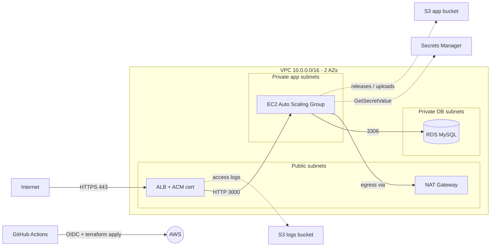

# AWS Infrastructure & CI/CD with Terraform

Node.js (Express) app on an EC2 Auto Scaling Group behind an HTTPS ALB, backed by RDS MySQL.
Everything is provisioned with Terraform and deployed through GitHub Actions.

## Architecture



## Repo layout
- `app/` Express + mysql2 app (reads DB creds from Secrets Manager)
- `terraform/` all infrastructure
- `.github/workflows/terraform.yml` fmt, validate, plan (PR) -> apply + health check (main)

## Prerequisites
- AWS account, AWS CLI, Terraform >= 1.10
- A domain with a **Route53 public hosted zone** (needed for the ACM certificate)

## One-time bootstrap
```bash
export AWS_REGION=ap-south-1
ACCOUNT=$(aws sts get-caller-identity --query Account --output text)
BUCKET=tfstate-$ACCOUNT-devops-task
aws s3api create-bucket --bucket $BUCKET --region $AWS_REGION \
  --create-bucket-configuration LocationConstraint=$AWS_REGION
aws s3api put-bucket-versioning --bucket $BUCKET --versioning-configuration Status=Enabled
aws s3api put-bucket-encryption --bucket $BUCKET --server-side-encryption-configuration \
  '{"Rules":[{"ApplyServerSideEncryptionByDefault":{"SSEAlgorithm":"AES256"}}]}'
aws s3api put-public-access-block --bucket $BUCKET --public-access-block-configuration \
  BlockPublicAcls=true,IgnorePublicAcls=true,BlockPublicPolicy=true,RestrictPublicBuckets=true
```

## Deploy locally
```bash
cd terraform
cp terraform.tfvars.example terraform.tfvars   # edit domain_name
terraform init \
  -backend-config="bucket=$BUCKET" -backend-config="key=devops-task/terraform.tfstate" \
  -backend-config="region=$AWS_REGION" -backend-config="encrypt=true" -backend-config="use_lockfile=true"
terraform plan
terraform apply
```

## GitHub Actions setup (OIDC, no static keys)
1. IAM -> Identity providers -> add `token.actions.githubusercontent.com`, audience `sts.amazonaws.com`.
2. Create IAM role trusted by that provider, with condition `token.actions.githubusercontent.com:sub` = `repo:<user>/<repo>:*`. Attach permissions for the services used (for the assessment `AdministratorAccess`; note in docs that production would use a scoped policy).
3. Repo settings -> Secrets: `AWS_ROLE_ARN`. Variables: `AWS_REGION`, `TF_STATE_BUCKET`, `DOMAIN_NAME`.
4. Settings -> Environments -> create `production` (optionally require reviewer).
5. Push to `main` -> pipeline runs plan, apply, health checks.

## Validation
```bash
curl -I http://app.yourdomain.com          # 301 -> https
curl https://app.yourdomain.com/health     # {"status":"ok"}
curl https://app.yourdomain.com/health/db  # {"status":"ok","db":"connected"}
curl -X POST https://app.yourdomain.com/api/notes -H 'content-type: application/json' -d '{"text":"hello"}'
curl https://app.yourdomain.com/api/notes
```
Also verify: both targets healthy in the target group; instances in 2 AZs; ALB log objects appear in the logs bucket; RDS `Publicly accessible = No`; terminate one instance and watch the ASG replace it.

## Security decisions
- Private subnets for app and DB; DB subnets have no internet route
- SG chaining: internet -> ALB(443) -> app(3000) -> DB(3306); no SSH, use SSM Session Manager
- RDS storage encrypted, EBS encrypted, S3 SSE + public access blocked + TLS-only policy
- DB password generated by Terraform, stored in Secrets Manager, read at runtime via IAM role
- IMDSv2 enforced; TLS 1.3 policy on ALB; HTTP redirects to HTTPS
- Terraform state in encrypted, versioned S3 with native locking (state contains the generated DB password, so restrict bucket access)

## Cost / trade-offs
Single NAT gateway and single-AZ RDS by default to limit cost; set `db_multi_az = true` and one NAT per AZ for full HA.
**Run `terraform destroy` after submission to avoid charges.**
# aws-devops-terraform-assignment
